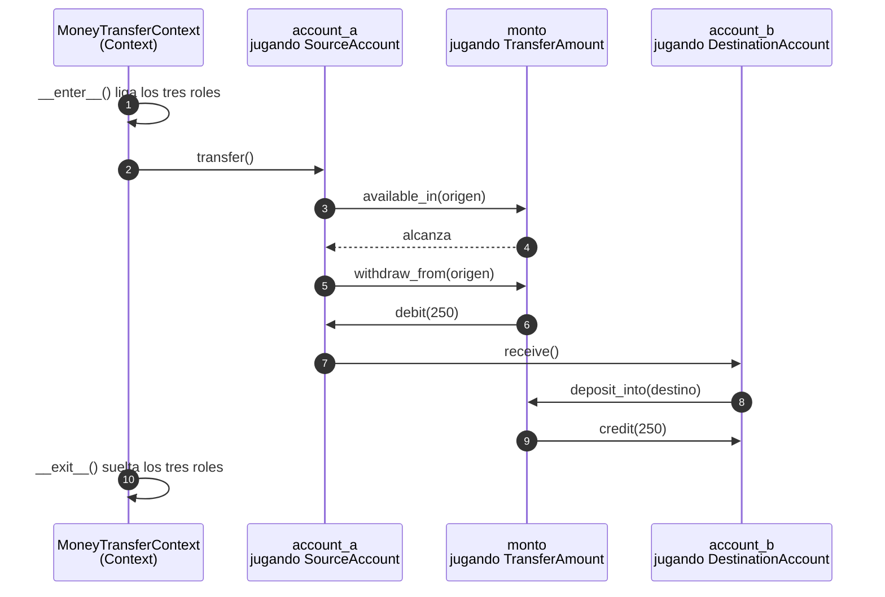
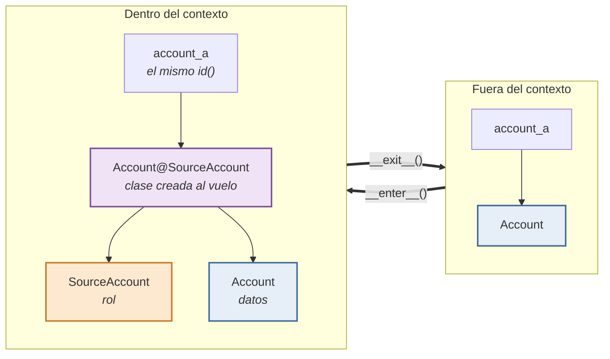
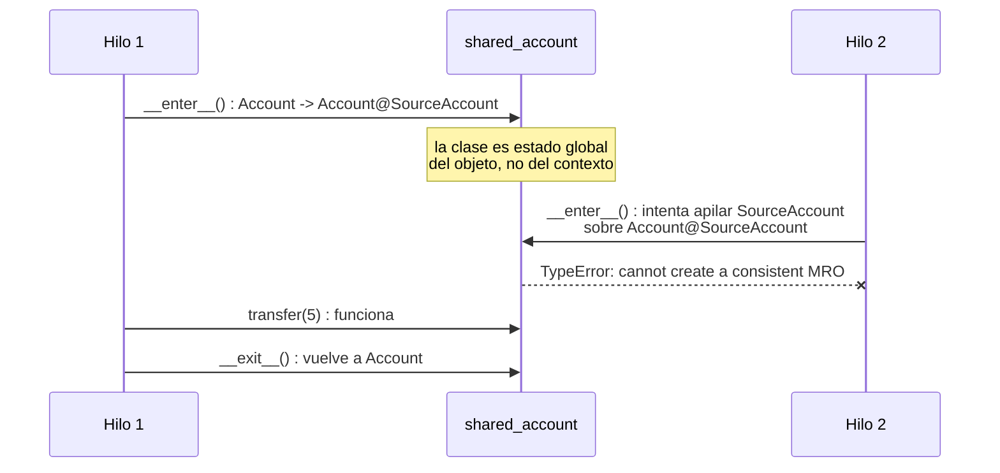

En [la primera parte](/posts/dci-data-context-interaction-reenskaug/) conté de dónde salió DCI: Trygve Reenskaug, el autor de MVC, pasó su jubilación buscando una forma de que el código muestre lo que el sistema *hace* y no sólo lo que el sistema *es*. La propuesta se llama *Data, Context, Interaction* y se resume en tres elementos. **Data**: los objetos de dominio son pequeños y apenas inteligentes — la `Account` sabe su saldo, cómo sumarlo y restarlo, nada más. **Context**: el caso de uso deja de ser un método suelto y pasa a ser un objeto de primera clase, que existe mientras el caso de uso está funcionando. **Interaction**: los roles —`SourceAccount`, `DestinationAccount`— son comportamientos que se le adosa a un objeto de datos *mientras dura el contexto*, de esa manera, el algoritmo que ejecutan entre todos reside en un solo lugar[^dci_letras].

Para que DCI funcione en Python hace falta un mecanismo poco habitual: **inyectarle comportamiento a un objeto en tiempo de ejecución, por la duración de un contexto, sin tocar su clase y sin que el objeto pierda su identidad**. Java y C# no permiten cambiar la clase de un objeto existente; Python sí. Así que lo vamos a implementar y a evaluar las limitaciones del modelo de objetos de Python para este caso.

> **Antes de copiar y pegar.** Todo el código de este post vive en un repositorio aparte: **[CesarBallardini/dci-in-python](https://github.com/CesarBallardini/dci-in-python)**. El mecanismo completo es biblioteca estándar —`contextvars` y `functools`, nada más—, así que no hay ninguna dependencia que instalar para que DCI funcione. Los fragmentos de código son copia textual del repositorio, sin los docstrings, y la primera línea de cada uno dice de qué archivo salen. Para correr el repositorio sí hacen falta [uv](https://docs.astral.sh/uv/) y Python 3.14:
>
> ```console
> git clone https://github.com/CesarBallardini/dci-in-python
> cd dci-in-python/
> make install
> make demo
> ```
>
> `make demo` imprime todas las salidas que van apareciendo en este post. Y `make test` corre la suite.
>
> Los ejemplos también corren en el navegador, sin instalar nada, en <a href="https://katra.ballardini.com.ar/dci-in-python/" target="_blank" rel="noopener">los cuadernos de JupyterLite del repositorio</a>. Ejecutan el mismo código con Pyodide, que es CPython 3.14 compilado a WebAssembly. Cada sección de este post enlaza el cuaderno que le corresponde, y <a href="https://katra.ballardini.com.ar/dci-in-python/notebooks/index.html?path=05-run-the-tests.ipynb" target="_blank" rel="noopener">el cuaderno 5</a> corre la suite de tests. No corren en el navegador los ejemplos con hilos, porque Pyodide no puede crear un hilo, ni la biblioteca `roles`, que no funciona en Python 3.14.
>
> `make` sin argumentos lista el resto: linter, los dos type checkers y los escaneos de seguridad. Todo eso —qué hace cada herramienta, cómo se actualizan las dependencias, cómo se arma la rueda— está en [`TOOLING.md`](https://github.com/CesarBallardini/dci-in-python/blob/main/TOOLING.md).

## La transferencia bancaria

El ejemplo canónico de DCI es la transferencia bancaria — es el que usan Reenskaug y Coplien en el paper, donde el algoritmo se escribe entre dos roles, *Source Account* y *Destination Account*[^dci]. En el capítulo de arquitectura, en cambio, dicen que «un modelo mental posible tiene **tres** roles»: *Source Account*, *Destination Account* y *Transfer Amount*[^asa].

**En el navegador:** las tres versiones de esta sección están en <a href="https://katra.ballardini.com.ar/dci-in-python/notebooks/index.html?path=01-the-mechanism.ipynb" target="_blank" rel="noopener">el cuaderno 1, *The mechanism*</a>.

### Versión 1: la cuenta que sabe demasiado

```python
# src/banking/alternatives/fat_account.py
class FatAccount:
    def __init__(self, holder: str, balance: Money) -> None:
        self.holder = holder
        self.balance = balance

    def transfer_to(self, destination: FatAccount, amount: Money) -> None:
        if self.balance < amount:
            raise InsufficientFundsError(self.holder)
        self.balance = self.balance - amount
        destination.balance = destination.balance + amount
```

Así es como lo escribiríamos casi todos. El problema aparece con el tiempo. La cuenta origen ahora sabe qué es una transferencia. En la próxima iteración va a saber de comisiones; en la siguiente, de límites diarios; después, de horarios de acreditación, de cuentas embargadas, de CBU contra CVU, de si el destino es de otro banco. Le cargamos el caso de uso a una entidad.  La entidad cambia por otros motivos y a otro ritmo. Podemos apreciar que ninguna de estas *reglas adicionales* tiene que ver con lo que una cuenta *es*.

#### Versión 2: la cuenta anémica y el servicio

```python
# src/banking/alternatives/anemic_service.py
class AnemicAccount:
    def __init__(self, holder: str, balance: Money) -> None:
        self.holder = holder
        self.balance = balance


class TransferService:
    def transfer(self, source: AnemicAccount, destination: AnemicAccount, amount: Money) -> None:
        if source.balance < amount:
            raise InsufficientFundsError(source.holder)
        source.balance = source.balance - amount
        destination.balance = destination.balance + amount
```

Ésta es la que se ve en muchos de los sistemas de línea de negocio: es una reacción al problema anterior. La cuenta volvió a ser una entidad pequeña. Pero `AnemicAccount` ya no hace *nada*: es un registro. Y `TransferService` manipula los atributos de otro objeto desde afuera —le resta el saldo con `source.balance = source.balance - amount`—, que es lo que el encapsulación busca evitar. El resultado es una función con una clase que la envuelve.

Además, en ninguna de las dos versiones existen «origen» y «destino» como *cosas*. Son nombres de parámetros, y dejan de existir cuando la función retorna.

#### Versión 3: DCI

Empecemos por la **Data**, que es lo único que se parece a lo anterior. Son dos objetos, y los dos son igual de simples. Primero la plata:

```python
# src/banking/data/money.py
@functools.total_ordering
class Money:
    def __init__(self, amount: int, currency: str = 'ARS') -> None:
        self.amount = amount
        self.currency = currency

    def _same_kind(self, other: Money) -> Money:
        if self.currency != other.currency:
            raise CurrencyMismatchError(f'{self.currency} vs {other.currency}')
        return other

    def __add__(self, other: Money) -> Money:
        return Money(self.amount + self._same_kind(other).amount, self.currency)

    def __sub__(self, other: Money) -> Money:
        return Money(self.amount - self._same_kind(other).amount, self.currency)

    def __eq__(self, other: object) -> bool:
        if not isinstance(other, Money):
            return NotImplemented
        return (self.amount, self.currency) == (other.amount, other.currency)

    def __lt__(self, other: Money) -> bool:
        return self.amount < self._same_kind(other).amount

    def __hash__(self) -> int:
        return hash((self.amount, self.currency))

    def __repr__(self) -> str:
        return f'Money({self.amount}, {self.currency!r})'
```

`amount` va en unidades mínimas —centavos—, así evitamos el uso de `float` en montos de dinero. Pesos y dólares no se suman en ningún contexto, lo cual es una regla de negocio sobre montos de dinero en diferentes monedas. `Money` es un *value object*.

Después la cuenta, que sigue siendo igual de simple:

```python
# src/banking/data/account.py
class Account:
    def __init__(self, holder: str, balance: Money) -> None:
        self.holder = holder
        self.balance = balance

    def debit(self, amount: Money) -> None:
        self.balance = self.balance - amount

    def credit(self, amount: Money) -> None:
        self.balance = self.balance + amount

    def __repr__(self) -> str:
        return f'Account({self.holder!r}, {self.balance.amount})'
```

`debit` y `credit` no son reglas de negocio: son lo que una cuenta sabe hacer consigo misma, como un entero sabe sumarse. No hay ninguna validación de saldo ahí, porque el piso del saldo no es un dato de la cuenta: en una caja de ahorro el límite es cero, en una cuenta corriente con acuerdo de descubierto es el negativo del acuerdo, y hay débitos —una comisión, un contracargo, un embargo— que entran igual y dejan el saldo en rojo. Cuánto se puede sacar lo decide el caso de uso, no la cuenta.

> **Una advertencia sobre `Money`.** Si lo escribís como `@dataclass(frozen=True)` —la forma habitual, y correcta, de escribir un value object— el ejemplo entero deja de funcionar. Los detalles están más abajo.

Después vienen los **roles**, que son la **Interaction**:

```python
# src/banking/roles/money_transfer.py
class SourceAccount:
    def transfer(self: AccountLike) -> None:
        transfer = context(_RunningTransfer)
        if not transfer.amount.available_in(self):
            raise InsufficientFundsError(self.holder)
        transfer.amount.withdraw_from(self)
        transfer.destination.receive()


class DestinationAccount:
    def receive(self: AccountLike) -> None:
        context(_RunningTransfer).amount.deposit_into(self)


class TransferAmount:
    def available_in[M: MoneyLike](self: M, account: AccountLike[M]) -> bool:
        return account.balance >= self

    def withdraw_from[M: MoneyLike](self: M, account: AccountLike[M]) -> None:
        account.debit(self)

    def deposit_into[M: MoneyLike](self: M, account: AccountLike[M]) -> None:
        account.credit(self)
```

Este fragmento concentra la inusual idea. Ninguno de los tres **hereda de nada** y ninguno **se instancia nunca**. `SourceAccount` usa `self.holder` sin haberlo definido en ninguna parte, y `TransferAmount` le pide a la cuenta `balance`, `debit()` y `credit()` sin saber qué es una cuenta. Son clases escritas para vivir prestadas adentro de otro objeto. Y lo que saben está delimitado con precisión: **no saben de qué clase es el objeto que los va a jugar, pero sí qué protocolo entiende** — `holder`, `balance`, `debit()`, `credit()`. Por eso pueden usarlo. Y ese contrato no queda implícito: es la anotación de `self`. `self: AccountLike` no nombra ninguna clase, nombra un `typing.Protocol` estructural, que cualquier objeto con esos cuatro miembros satisface:

```python
# src/banking/data/account.py y src/banking/data/money.py
class AccountLike[M: MoneyLike = Money](Protocol):
    @property
    def holder(self) -> str:
        ...

    @property
    def balance(self) -> M:
        ...

    def debit(self, amount: M, /) -> None:
        ...

    def credit(self, amount: M, /) -> None:
        ...


class MoneyLike(Protocol):
    def __ge__(self, other: Self, /) -> bool:
        ...
```

Ese contrato es todo lo que el rol exige; es la misma condición que Reenskaug le pedía a Simula en 1970 y no conseguía: componentes que se hablan mediante un protocolo estándar y son opacos por dentro. Para hablar con sus pares le preguntan al contexto —`context(_RunningTransfer).destination`, `.amount`—: el rol no conoce al otro objeto, conoce al *otro rol*, y lo alcanza a través del contexto. `context()` es una función de la maquinaria, la veremos en la sección siguiente.

Además, la firma de `transfer` se quedó **sin parámetros**. El monto ya no es un argumento que se pasea de función en función; es un participante más, y el origen lo averigua usando el mismo mecanismos que usa el destino, preguntándole al contexto. Eso es lo que quiere decir que el monto «juega un rol»: no es un dato que se mueve entre objetos, es alguien con un papel. `TransferAmount` sabe restarse de una cuenta y sumarse a otra, pero ninguna de las dos cuentas sabe cómo se hace eso.

La regla del saldo terminó en `TransferAmount.available_in()`. No está en `Account` —que no tiene por qué saber si puede quedar en rojo— ni suelta en el guion. La pregunta «¿alcanza?» es sobre el monto y la cuenta juntos, en este caso de uso.

`withdraw_from` hace algo que a primera vista parece un error: le pasa `self` a `account.debit()`, un método que espera un monto. En tiempo de ejecución es correcto: dentro del contexto `self` **es** el monto, con su `id()` y su `isinstance` intactos, y también es un `TransferAmount`. Para que el type checker también lo vea, `self` no está anotado como `Money` —los dos checkers lo rechazan, porque `Money` no es supertipo de `TransferAmount`— sino como `M`, una variable de tipo atada a `MoneyLike`. La cuenta `AccountLike[M]`: «una cuenta que guarda montos como yo». Con eso `account.debit(self)` cierra sin ningún `cast`[^cast]. La limitación de fondo —que el type checker no puede ver el mecanismo se muda al Context.

Y finalmente el **Context**, el caso de uso transformado en un objeto:

```python
# src/banking/contexts/money_transfer.py
class MoneyTransferContext(Context):
    roles: ClassVar[Mapping[str, type]] = {
        'source': SourceAccount,
        'destination': DestinationAccount,
        'amount': TransferAmount,
    }

    def __init__(self, source: AccountLike, destination: AccountLike, amount: Money) -> None:
        self.source = source
        self.destination = destination
        self.amount = amount

    def run_script(self) -> None:
        playing(self.source, SourceAccountPlayer).transfer()

    def execute(self) -> None:
        with self:
            self.run_script()
```

Ahí está el caso de uso completo, en un solo lugar, en un renglón: *el origen transfiere*. Ni siquiera hace falta decir qué, porque el monto ya está en escena. Ése es el objetivo de DCI. El `with self:` es el momento durante el cual los tres participantes se encuentran y juegan sus papeles.



El paso 2 del diagrama, `transfer()`, corresponde a la línea `playing(self.source, SourceAccountPlayer).transfer()` de `run_script`. Es el único punto del diseño que el type checker no puede verificar:

- Para el type checker, `self.source` tiene el tipo que declara el constructor, `AccountLike`, y `AccountLike` no tiene un método `transfer()`.
- En tiempo de ejecución, después del paso 1 (`__enter__`), la clase de `self.source` es `Account@SourceAccount`. Esa clase se crea durante la ejecución y no está definida en ningún archivo fuente, por lo que el type checker no la conoce.
- `playing(self.source, SourceAccountPlayer)` devuelve el mismo objeto y le indica al type checker que su tipo es `SourceAccountPlayer`. No hace ninguna comprobación en tiempo de ejecución. Es la única aserción de tipo del flujo, y está en el lugar donde ocurre el ligado, en vez de repetirse como un `cast` en cada llamada a un rol.

`SourceAccountPlayer` combina `AccountLike` con el método `transfer()` del rol. Python no tiene tipos intersección, de modo que cada combinación se declara a mano como un `Protocol`, una por rol. Los mismos protocolos le asignan tipo a lo que cada rol obtiene del contexto en los pasos 3, 5, 7 y 8: `_RunningTransfer` declara `source`, `destination` y `amount` con estos tipos.

```python
# src/banking/roles/money_transfer.py
class SourceAccountPlayer(AccountLike, Protocol):
    def transfer(self) -> None:
        ...


class DestinationAccountPlayer(AccountLike, Protocol):
    def receive(self) -> None:
        ...


class TransferAmountPlayer(MoneyLike, Protocol):
    def available_in(self, account: AccountLike[Money], /) -> bool:
        ...

    def withdraw_from(self, account: AccountLike[Money], /) -> None:
        ...

    def deposit_into(self, account: AccountLike[Money], /) -> None:
        ...


class _RunningTransfer(Protocol):
    source: SourceAccountPlayer
    destination: DestinationAccountPlayer
    amount: TransferAmountPlayer
```

#### Un paréntesis: la objeción de Feathers

En el segundo renglón del diagrama, `transfer()` se lo pedimos al **origen**. Ahí aparece la crítica más citada que recibió DCI, la de Michael Feathers, que en [la primera parte](/posts/dci-data-context-interaction-reenskaug/) dejé sin contestar. Dice que elegir la cuenta origen es arbitrario, porque para el usuario la transferencia no la hace ninguna de las dos cuentas. Zabroski propuso un objeto aparte, un `TransferSlip`, para que esa lógica viva ahí[^infoq_feathers]. La objeción es relevante, porque DCI sostiene que el código se parece a cómo la gente cuenta lo que hace.

Con el código adelante ya se puede contestar, la respuesta en dos partes.

**La primera: Feathers tiene razón, y el tercer rol lo deja ver.** Que el origen empiece el guion es una decisión de quien diseña, no una verdad sobre las cuentas. Se nota en dónde terminó la regla del saldo: `available_in()` no está en `Account`, está en `TransferAmount`, porque la pregunta «¿alcanza?» no es sobre la cuenta sola sino sobre el monto y la cuenta juntos, y sólo en este caso de uso. Ninguna de las dos cuentas es dueña de esa regla. En la versión de dos roles del paper esa decisión no se ve y parece inevitable; con el monto como tercer rol queda claro que alguien la tomó.

**La segunda: el `TransferSlip` que pide Zabroski ya está escrito, y se llama `MoneyTransferContext`.** Es el objeto que existe mientras dura la transferencia, conoce a los tres participantes y tiene el guion. Es el comprobante (*slip*) que pedía Zabroski. Lo que la objeción pide ya existe en DCI: es el Context.

Lo que sí queda en pie es que el guion tiene que empezar en algún lado, y ese `.transfer()` sobre `self.source` es una elección. Podría ser el monto el que se mueve. La diferencia con el código anterior es que ahora la elección es **un renglón, en un solo archivo**. En la versión con `TransferService` esa decisión estaba igual de tomada, pero repartida entre la firma del método y el cuerpo.

### La maquinaria

Falta lo que hace que eso funcione. El mecanismo son dos archivos y, sin docstrings, menos de sesenta líneas de código, sin instalar nada. El que liga el rol en la clase es éste:

```python
# src/banking/dci/class_binding.py
@functools.cache
def _class_with_role(cls: type, role: type) -> type:
    return type(f'{cls.__name__}@{role.__name__}', (role, cls), {})


class Context(BaseContext):
    def _bind(self, obj: object, role: type) -> None:
        original = obj.__class__
        obj.__class__ = _class_with_role(original, role)
        self._undo.append(functools.partial(self._restore, obj, original))

    @staticmethod
    def _restore(obj: object, original: type) -> None:
        obj.__class__ = original
```

Y éste es el ciclo de vida que comparten todos los binders —entrar, salir, el `ContextVar`—, en `base.py`:

```python
# src/banking/dci/base.py
_current_context: contextvars.ContextVar[BaseContext] = contextvars.ContextVar('dci_context')


@overload
def context() -> BaseContext: ...

@overload
def context[RunningContext](expected: type[RunningContext]) -> RunningContext: ...

def context(expected: type | None = None) -> Any:
    return _current_context.get()


def playing[Player](obj: object, player: type[Player]) -> Player:
    return cast('Player', obj)


class BaseContext:
    roles: ClassVar[Mapping[str, type]] = {}

    _active: bool = False

    _token: contextvars.Token[BaseContext]

    _undo: list[Callable[[], None]]

    def __enter__(self) -> Self:
        if self._active:
            raise RuntimeError(f'{type(self).__name__} is already running: a context is not re-entrant')
        self._token = _current_context.set(self)
        self._undo = []
        try:
            for attribute, role in self.roles.items():
                self._bind(getattr(self, attribute), role)
        except BaseException:
            self._release()
            raise
        self._active = True
        return self

    def __exit__(self, *exc_info: object) -> bool:
        self._release()
        return False

    def _bind(self, obj: object, role: type) -> None:
        raise NotImplementedError

    def _release(self) -> None:
        failure: BaseException | None = None
        try:
            for undo in reversed(self._undo):
                try:
                    undo()
                except BaseException as exc:
                    failure = failure or exc
        finally:
            self._undo = []
            self._active = False
            _current_context.reset(self._token)
        if failure is not None:
            raise failure
```

El mecanismo central es una sola línea: `obj.__class__ = ...`. Python te deja reasignar la clase de una instancia viva. Entonces al entrar al contexto fabricamos al vuelo una subclase que mezcla el rol con la clase original —`Account@SourceAccount`— y le cambiamos la clase al objeto; al salir, se la devolvemos.



El `functools.cache` es para no fabricar una clase nueva en cada transferencia. El `ContextVar` —y no una variable global— es para que la búsqueda del contexto actual funcione bien con hilos y con `async`.

Lo demás de `BaseContext` es lo que hace falta para que eso no deje basura si algo falla en el camino. Cada `_bind` anota en `_undo` cómo deshacerse, así que si el tercer ligado falla, `__enter__` deshace los dos primeros y saca el contexto del `ContextVar` antes de dejar pasar el error: o se ligan todos, o ninguno. Y `_active` impide entrar dos veces al mismo contexto, que de otro modo pisaría el `_token` y rompería la salida.

#### De qué está hecho, exactamente

Éstas son las facilidades de Python que este código necesita para funcionar:

| Recurso                                                  | Para qué lo necesita el estilo                                                                              |
| -------------------------------------------------------- | ----------------------------------------------------------------------------------------------------------- |
| `obj.__class__ = ...` sobre una instancia viva           | el objeto *se convierte* en el rol y conserva su `id()`                                                     |
| `type(nombre, bases, ns)`                                | fabricar la mezcla del rol con la clase de datos al ligar                                                   |
| `contextvars.ContextVar`                                 | que un rol alcance a sus pares sin guardar referencias, con hilos y con `async`                             |
| el protocolo de context manager                          | que el caso de uso tenga cierta duración, y que el rol se libere aunque se lance una excepción en el cuerpo |
| `types.MethodType` + `object.__setattr__`                | la segunda estrategia de ligado, la que no toca la clase                                                    |
| metaclase, y `__name__` / `__qualname__` modificables    | que los mensajes de error nombren una clase que existe                                                      |
| `typing.Protocol` estructural                            | que un rol exija un protocolo y no una clase base                                                           |
| `self` anotado con un protocolo, y parámetros de tipo    | que cada rol diga qué le exige a su actor, sin un `cast`                                                    |
| `typing.cast`, una sola vez, adentro de `playing()`      | afirmar lo único que el checker no puede ver: que adentro del `with` el participante ya juega el rol        |
| `typing.Self`, `ClassVar`, el `/` posicional             | que el propio mecanismo pase los type checkers sin usar supresiones                                         |
| `functools.cache`, `weakref.finalize`, `threading.RLock` | fabricar la clase una sola vez; que el lock de cada participante desaparezca junto con el objeto            |

Las salidas 1 a 4 de la demo están en <a href="https://katra.ballardini.com.ar/dci-in-python/notebooks/index.html?path=01-the-mechanism.ipynb" target="_blank" rel="noopener">el cuaderno 1</a>, sección *Version 3: DCI*. El resultado:

```text
==============================================================
1. The transfer works
==============================================================
Account('Alice', 750) Account('Bob', 250)
```

La secuencia temporal es:

```text
==============================================================
2. Roles are temporary
==============================================================
before the context, does .transfer exist? False
inside:   type(a).__name__ = Account@SourceAccount
inside:   isinstance(a, Account) = True
inside:   does .transfer exist? True
inside:   the amount plays a role too -> Money@TransferAmount
outside:  type(a).__name__ = Account
outside:  does .transfer exist? False
outside:  type(amount).__name__ = Money
```

Por fuera de un contexto, si intentamos un `transfer`, se lanza la excepción `AttributeError`. Dentro del contexto, sigue siendo instancia de `Account`.

El `Money@TransferAmount` muestra que al monto le pasa lo mismo que a la cuenta. Entra a escena, le aparece un método que antes no tenía, y cuando el contexto termina vuelve a ser un monto y nada más.

La misma cuenta que fue origen puede ser destino en la transferencia siguiente, sin agregarle una línea:

```text
==============================================================
3. The same object plays the opposite role in another context
==============================================================
Account('Alice', 850) Account('Bob', 150)
```

Éste es el aspecto central de la propuesta: los roles son **contextuales**. Un objeto no *tiene* un rol, un objeto *juega* un rol, y sólo mientras dura la obra. Cuando el contexto termina, la cuenta vuelve a ser una cuenta. Es más parecido a cómo funciona el mundo real que la herencia, donde los métodos que un objeto puede usar se los da su clase, y no cambian nunca.

La identidad se conserva — no estamos devolviendo otro objeto:

```text
==============================================================
4. Identity is preserved (this is not a wrapper)
==============================================================
same id inside?  True
same id outside? True
```

Hasta acá, DCI funciona en Python: cincuenta líneas, biblioteca estándar, y el caso de uso se lee de corrido en el contexto.

### Algunos escenarios donde el modelo de objetos de Python falla

**En el navegador:** <a href="https://katra.ballardini.com.ar/dci-in-python/notebooks/index.html?path=03-where-python-says-no.ipynb" target="_blank" rel="noopener">el cuaderno 3, *Where Python says no*</a>, con las secciones 5, 5b y 6 de la demo.

**Primero: no funciona con `__slots__`.** Basta que la clase de dominio use `__slots__` —o sea, cualquier clase optimizada para memoria, y varias cosas que generan las bibliotecas— para que la reasignación de `__class__` sea ilegal:

```text
==============================================================
5. Where class binding fails: __slots__
==============================================================
TypeError: __class__ assignment: 'SlottedAccount@SourceAccount' object layout differs from 'SlottedAccount'
```

Python sólo permite reasignar `__class__` entre clases con el mismo *layout* de objeto, y la clase sintetizada no lo comparte. Una explicación frecuente es «los slots le sacan el `__dict__` al objeto», pero no es correcta: basta un `__slots__ = ()` —que no saca nada— para que la reasignación deje de ser legal, y sigue siendo ilegal en una subclase que recuperó su `__dict__`. Lo que importa no es si el objeto tiene diccionario sino de qué clase hereda su layout, y el `__slots__` de un ancestro cualquiera ya lo decide. Tampoco se arregla poniéndole `__slots__ = ()` al rol para que no aporte nada: probado, falla igual. No encontré forma de evitarlo[^layout].

**Segundo: el mismo resultado por otro camino.** `__slots__` puede parecer una optimización poco frecuente. Pero se llega al mismo resultado por un camino mucho más común: la forma más idiomática que hay de escribir un value object.

```python
# demo/dci_demo.py
@dataclass(frozen=True)
class FrozenMoney:
    amount: int
    currency: str = 'ARS'
```

Es la forma habitual de escribir `Money` en 2026, y no puede jugar un rol:

```text
==============================================================
5b. The same failure, reached by the idiomatic value object
==============================================================
FrozenInstanceError: cannot assign to field '__class__'
the field it refuses to assign is __class__
```

No es la misma causa que la de `__slots__`: acá el layout no tiene nada que ver. Un dataclass frozen reemplaza `__setattr__` por uno que rechaza *todo*, y `__class__` es un atributo como cualquier otro. El mensaje indica el campo que no puede asignar.

Entonces, para jugar un rol, el objeto tiene que tener `__dict__` **y** tiene que dejarse reasignar `__class__`. Eso deja afuera `__slots__`, deja afuera `frozen=True`, y deja afuera `@attrs.define` por partida doble, porque trae `slots=True` de fábrica[^instancia].

**Tercero: dos contextos vivos sobre el mismo objeto interfieren entre sí.**

```text
==============================================================
6. Where class binding fails: two live contexts over one object
==============================================================
with c1 open: type(shared).__name__ = Account@SourceAccount
c2.__enter__() -> TypeError: Cannot create a consistent method resolution order (MRO) for bases SourceAccount, Account@SourceAccount
after closing c1: Account
```

También pasa con hilos. Dos requests concurrentes que toquen la misma cuenta:

```text
==============================================================
6b. The same case, served by two threads
==============================================================
failure: ('fast', 'TypeError', 'Cannot create a consistent method resolution order (MRO) for bases SourceAccount, Account@SourceAccount')
final balances: Account('Erin', 999995) Account('Frank', 5) Account('Grace', 0)
```

La sección 6b no corre en el navegador, porque Pyodide no puede crear un hilo. <a href="https://katra.ballardini.com.ar/dci-in-python/notebooks/index.html?path=03-where-python-says-no.ipynb" target="_blank" rel="noopener">El cuaderno 3</a>, en la sección *The same overlap, served concurrently*, produce la misma superposición con dos tareas de `asyncio` en un solo hilo: alcanza con que el mismo objeto esté adentro de dos contextos vivos a la vez.



La transferencia del hilo lento se completa y la del rápido falla con un error de MRO que no tiene nada que ver con transferir plata. Ése es el caso **favorable**: la excepción se produce al ligar, antes de tocar un saldo.

El caso grave aparece cuando los dos contextos le dan al objeto roles **distintos** — la misma cuenta es origen de una transferencia y destino de otra, que en un banco pasa todo el tiempo. Ahí el segundo ligado no falla: apila, y la clase queda `Account@SourceAccount@DestinationAccount`. Cuando el primer contexto sale, le devuelve al objeto la clase que él había guardado, y el segundo, que sigue vivo, se queda sin sus métodos. Y cuando ese segundo sale, restaura lo que él había guardado: la cuenta queda siendo `Account@SourceAccount` **fuera de todo contexto y de manera permanente**. En ningún momento se produce una excepción.

La causa de fondo es sencilla: **el `__class__` de un objeto es estado global de ese objeto**, y DCI lo usa como si fuera estado local del contexto. El `ContextVar` resuelve la mitad del problema —cuál es *mi* contexto— y no toca la otra mitad —qué clase tiene el objeto compartido—.

La solución es directa: si dos contextos no pueden compartir el `__class__` de un objeto, que no lo tengan al mismo tiempo. Un lock por participante —por participante y no por rol, así que cubre las dos formas de pisarse—, tomado al entrar y soltado al salir. Las dos transferencias pasan, la segunda espera su turno[^serializado].

Lo que el lock **no** hace es permitir que dos contextos jueguen el mismo objeto a la vez. Los pone en fila. En una cuenta con contención el throughput es un caso de uso por vez, que es exactamente lo que te da el row lock de la base de datos. Y multiproceso, dicho sea de paso, nunca estuvo en discusión: procesos distintos tienen objetos distintos. El problema nunca fueron «los hilos», fue el mismo objeto en memoria dentro de dos contextos activos.

**Cuarto: el debugger muestra una clase que no está en el código fuente.** `type(a).__name__` devuelve `Account@SourceAccount`, una clase que no existe en ningún archivo, que no vas a poder buscar con grep, que tu IDE no autocompleta y sobre la cual el type checker no puede dar pistas. `mypy` sabe que `self.holder` existe dentro de `SourceAccount` sólo porque se lo dijimos anotando `self`; la clase en la que eso es cierto no la ve nunca. Y cuando falle en producción, el stack trace va a nombrar una clase que no tiene contrapartida en un archivo fuente.

Ésta también se puede mejorar, aunque menos que la anterior. A la clase sintetizada se le puede poner el `__name__` de la clase de datos, y entonces los mensajes de error vuelven a decir `'Account' object has no attribute ...` en vez de `'Account@SourceAccount'`. Lo que hace el trabajo es **renombrar** la clase, no una metaclase. Una metaclase que devuelva otro `__name__` arregla lo que ves al pedirlo y no toca los mensajes de error, porque CPython los arma con `tp_name`, que es de nivel C. Igual, es un cambio cosmético: seguís teniendo un objeto cuyo tipo dice `Account` y que tiene un método `transfer` que `Account` no define. Se reemplaza una inconsistencia por otra, de menor alcance[^disfraz].

El type checker no tiene arreglo, pero el problema se le puede achicar a un renglón. Los roles se anotan con lo que le exigen a su actor —`self: AccountLike`, y el monto con su variable de tipo—,de esa manera no necesitaremos usar `cast`. Lo que queda es el renglón del Context donde el participante ya juega el rol: `playing(self.source, SourceAccountPlayer)`. Ahí el checker tiene que creer lo que se le dice, porque la clase que lo probaría existirá recién en tiempo de ejecución.

### Cuatro maneras de prestar un rol

**En el navegador:** <a href="https://katra.ballardini.com.ar/dci-in-python/notebooks/index.html?path=02-four-binders.ipynb" target="_blank" rel="noopener">el cuaderno 2, *Four ways to bind a role*</a>, con el tipo que informa cada binder, los mensajes de error, `pickle` y el rol que aporta un método especial.

Los dos arreglos de arriba —el lock y el renombre— no son parches sueltos sobre la misma clase. Cada uno es un `Context` distinto. En el repositorio están los cuatro: `banking/dci/` es un paquete con el ciclo de vida en `base.py` y un módulo por binder. Comparten todo —el contexto reificado, el `ContextVar`, el ciclo de vida entero— y se diferencian en **un solo método**, el que liga: `_bind`. En el código de arriba ese ligado estaba suelto adentro del `__enter__`; en el repositorio es un método propio.

- **`Context`** — reasigna la clase. Usado en todo el post, es la línea base de comparación.
- **`TransparentContext`** — lo mismo, con la clase sintetizada **renombrada** a la de datos, así los mensajes de error dejan de nombrar una clase que no existe.
- **`SerializedContext`** — lo mismo, con los **participantes bloqueados** mientras dura el caso de uso. Es el del lock.
- **`InstanceContext`** — no toca la clase: le **escribe los métodos del rol al `__dict__` de la instancia**, como métodos ligados, y se los saca al salir.

`InstanceContext` merece un párrafo aparte, porque es el que más cambia. Al no tocar `__class__`, todo lo que dependía del layout deja de importar: el dataclass congelado juega su rol, y `type(obj)` siempre es `Account`, así que el debugger muestra la clase real. El type checker sigue sin ver nada. Arregla además la entidad del ORM declarativo, que no está en esa lista y es la que decide si esto se puede usar en un sistema que ya existe: va en la sección que sigue.

Y sin embargo no es el binder por defecto. Le quedan dos problemas.

El primero es que un rol pierde la posibilidad de aportar un método especial. Los dunders se resuelven en el tipo, nunca en la instancia, así que un `__lt__` metido en el diccionario del objeto no sirve, nadie lo va a buscar allí. Por eso `InstanceContext` directamente no lo liga. Un rol que quisiera hacer a su actor comparable, iterable o invocable puede hacerlo con `Context` —donde el rol termina en una clase de verdad— y con `InstanceContext`, que es un objeto, no una clase, no lo puede lograr de ninguna manera.

El segundo problema de `InstanceContext` es el `pickle`.

`Context` no funciona: la clase del objeto es `Account@SourceAccount`, no existe en ningún módulo, y `dumps` falla ahí mismo. `InstanceContext` no falla. Un método ligado se serializa como «llamá a `getattr` sobre este objeto con este nombre», así que `dumps` funciona y devuelve bytes — bytes que después nadie puede cargar, porque al reconstruir la cuenta no hay ningún `transfer` que `getattr` encuentre.

La diferencia está en **dónde** falla. Con `Context`, en el proceso que cometió el error. Con `InstanceContext`, en el que más tarde lea esa caché o esa cola, y con un traceback que nombra a `getattr` y a una `Account` común, sin nombrar roles ni contextos. Ninguno de los dos binders sobrevive un viaje de ida y vuelta, pero fallar en el acto y fallar en otro proceso no son la misma clase de problema[^deepcopy].

Queda el caso de los dos contextos vivos sobre el mismo objeto, y ahí `InstanceContext` no está peor que `Context`: está mejor. Los dos rechazan el segundo ligado, pero cada uno a su manera. `Context` falla porque no puede construir la clase mezclada, y el mensaje habla de MRO y de bases, no de roles ni de contextos. `InstanceContext` revisa, antes de escribir cada método, si el objeto ya tiene un atributo con ese nombre; si lo tiene, levanta un `RuntimeError` que describe la situación:

```text
RuntimeError: Account already has 'transfer': instance binding will not
overwrite it. Another context is playing this role, or the object defines
that name itself.
```

Este error está en <a href="https://katra.ballardini.com.ar/dci-in-python/notebooks/index.html?path=03-where-python-says-no.ipynb" target="_blank" rel="noopener">el cuaderno 3</a>, sección *The same overlap under `InstanceContext`*.

Los dos fallan en el momento del ligado, entonces, y ninguno de los dos permite que dos contextos le pidan **el mismo papel** al mismo objeto a la vez. Eso sólo lo consigue `SerializedContext`, poniéndolos en fila.

Y una aclaración sobre el chequeo de `InstanceContext`: **es una verificación, no un lock**. Revisa si el nombre está libre y después escribe, en dos pasos separados. Si dos hilos llegan justo entre uno y otro, los dos ven el nombre libre y los dos escriben. La ventana de oportunidad es corta pero existe, y por eso necesitamos el lock para cerrarla.

El chequeo sirve además para otra cosa: protege al objeto de dominio que **tiene un atributo propio** llamado igual que un método del rol. Sin él, el `__exit__` se lo borraría para siempre, porque al salir el binder no sabría distinguir lo que prestó de lo que ya estaba.

Ahora bien, todo lo anterior vale mientras los dos contextos quieran **el mismo rol**. Una cuenta que paga una transferencia mientras otra le deposita no necesita `SourceAccount` dos veces: necesita `SourceAccount` y `DestinationAccount`, y esos dos se apilan en una clase con un MRO perfectamente consistente. Los dos contextos ligan, las dos transferencias salen bien, los saldos quedan correctos. Lo que queda mal es lo que cada contexto **devuelve** al salir: la clase que se encontró al entrar. Si se solapan sin anidarse —el que abrió primero es el que cierra primero—, el último en salir le devuelve al objeto una clase que todavía tiene el rol del otro, y la cuenta queda jugando `SourceAccount` afuera de todo contexto. No se levantó ninguna excepción en ningún momento.

El error de MRO era, visto así, lo que hacía detectable el caso del mismo rol; acá no aparece. Y la cuenta queda en un estado inválido: la próxima transferencia que salga de ella —una request correcta, un rato después— es la que recibe el error, apilando `SourceAccount` sobre sí mismo. `InstanceContext` se salva por la misma razón por la que antes se negaba: `_bind` anota los nombres que escribió y `_strip` saca exactamente ésos, así que el orden en que salen no puede importar. `SerializedContext` lo cierra como cierra el otro caso, no dejándolos solapar. Los dos binders de clase, no[^goteo].

Puestos en una tabla, por lo que **hacen**:

|                                      |        `Context`        |    `Transparent`     |      `Serialized`       |    `Instance`     |
| ------------------------------------ | :---------------------: | :------------------: | :---------------------: | :---------------: |
| `type(obj).__name__` dice            | `Account@SourceAccount` |      `Account`       | `Account@SourceAccount` |     `Account`     |
| los mensajes de error nombran        | `Account@SourceAccount` |      `Account`       | `Account@SourceAccount` |     `Account`     |
| `pickle` con el rol puesto           |            ❌            |          ❌           |            ❌            | ⚠️ **falla tarde** |
| dos contextos vivos, mismo rol       |          ❌ MRO          |        ❌ MRO         |    ✅ **hacen fila**     |    ❌ se niega     |
| dos contextos vivos, roles distintos |  ❌ **fuga sin error**   | ❌ **fuga sin error** |    ✅ **hacen fila**     |   ✅ **intacto**   |
| un rol que aporta un dunder          |            ✅            |          ✅           |            ✅            |    ❌ imposible    |

Cada celda está verificada por un test: la tabla es un archivo `.feature` en el repositorio, con una fila de ejemplo por casillero, así que si una versión futura de Python cambia una respuesta la detectaremos[^tabla].

La tabla resume la sección: **cada binder arregla algo que a los otros se les escapa, y lo paga con de alguna manera**. Ninguna columna gana todas las filas.

### La pregunta que decide si esto se puede usar

Todas las cuentas que vimos hasta acá las fabricamos nosotros, en la línea de arriba, con `Account('Alice', Money(1000))`. En un sistema real, normalmente no es así. La cuenta **sale de algún lado**: de una consulta, de un modelo, de un payload que alguien validó. Y la clase de esa cuenta no la elegiste vos: la eligió, en buena parte, la biblioteca que se usa para dialogar con la base de datos.

Así que la pregunta que importa no es si DCI anda con una clase que escribí para el ejemplo. Es si anda con la que ya tenés. La respuesta está en: `tests/integration/test_orm_roles.py`, con una base SQLite, escribiendo la fila, cerrando la sesión, y recién ahí —con el objeto cargado de disco— dándole un papel.

El escenario con la base de datos real es interesante: **son los mismos tres roles, sin tocarles una línea, sobre cinco clases que no comparten ningún ancestro**. Se puede porque el rol nunca pidió una clase base: pide un `Protocol` estructural —`holder`, `balance`, `debit()`, `credit()`— y cualquier cosa que los tenga sirve. Es lo que decía cuando miramos `SourceAccount`: el rol no sabe de qué clase es su actor, pero sí qué protocolo entiende. Cada fila en la tabla es además una fila de ejemplo en un archivo `.feature`, igual que la tabla de los binders.

En el navegador, este escenario está en <a href="https://katra.ballardini.com.ar/dci-in-python/notebooks/index.html?path=04-five-designs.ipynb" target="_blank" rel="noopener">el cuaderno 4</a>, secciones *Five ways to write the domain object* y *The same five, with instance binding*, con SQLAlchemy sobre SQLite. Sale esto:

```text
==============================================================
8. Five ways to write the domain object, five outcomes
==============================================================
  WORKS  SQLAlchemy imperative (from the DB)    -> 750 / 250
  BREAKS SQLAlchemy declarative                 -> TypeError: __class__ assignment: 'DeclarativeAccount@SourceAccount' o
  WORKS  pydantic v2 BaseModel                  -> 750 / 250
  BREAKS attrs @define (slots by default)       -> TypeError: __class__ assignment: 'AttrsAccount@SourceAccount' object
  BREAKS @dataclass(frozen=True)                -> FrozenInstanceError: cannot assign to field '__class__'
```

Ordenado, y con el ligado en la instancia al lado, queda así:

| Cómo escribís tu objeto de dominio                    | ligando en la clase                    | ligando en la instancia |
| ----------------------------------------------------- | -------------------------------------- | :---------------------: |
| **SQLAlchemy, mapeo imperativo** (`map_imperatively`) | ✅ anda completo                        |            ✅            |
| pydantic v2 `BaseModel`                               | ✅ anda                                 |            ✅            |
| **SQLAlchemy, declarativo** (`class Account(Base)`)   | ❌ `object layout differs`              |     ✅ **rescatado**     |
| `@dataclass(frozen=True)`                             | ❌ `cannot assign to field '__class__'` |     ✅ **rescatado**     |
| attrs `@define` (`slots=True` por defecto)            | ❌ la misma barrera                     |   ❌ la misma barrera    |

**El mapeo declarativo no anda**, el más usado. `DeclarativeBase` aporta un `__slots__ = ()` —que no saca nada, pero decide el layout, como vimos— y al inyectarle un rol encima da una clase que CPython se niega a reasignar. Los slots vienen de la clase base de la que heredás, y con ellos la entidad no puede jugar un rol.

**El mapeo imperativo anda perfecto.** Ahí la tabla se describe por separado y la clase de dominio no se entera de que existe una base de datos: el test mapea el `Account` de verdad, el mismo del principio del post, sin agregarle una línea. El objeto se carga de disco, juega su papel, se lo modifica **a través del rol**, devuelve el rol al salir del contexto, y el cambio llega a la base. La vuelta completa.

Eso no es un detalle de SQLAlchemy. La limitación más grave que le encontramos a DCI no salió del lenguaje: salió de dejar que el framework de persistencia se meta adentro de la clase de dominio. Si tu `Account` hereda de `Base`, no puede actuar. Si tu `Account` es una clase común y el mapeo vive afuera, entonces se puede.

Que es, palabra por palabra, lo que DCI te venía pidiendo desde el principio. La Data tiene que ser *barely smart data*, decía Coplien, y uno lo lee como una preferencia estética sobre cómo modelar. Resulta que era la condición técnica para que el mecanismo funcione. Y es la misma regla a la que llegan DDD y Clean Architecture por su cuenta, con otros argumentos que no tienen nada que ver con reasignar `__class__`: que el dominio no sepa de la infraestructura.

### Un paréntesis: la biblioteca que hay, y por qué no anda

No es que nadie lo haya intentado. Para Python existe [`roles`](https://pypi.org/project/roles/), de Arjan Molenaar, que hace exactamente esto y con bastante más cuidado que mis treinta líneas: tiene metaclase propia, revocación explícita, un decorador `@in_context` y hasta integración con Django[^rolespy]. El ejemplo canónico de su documentación es también la transferencia bancaria.

El problema es la fecha. La última versión publicada es la 1.0.0 y salió el **28 de diciembre de 2020**; en PyPI declara `>=3.7,<4.0` y sus clasificadores no pasan de 3.8. Y cuando uno corre hoy el ejemplo de su propia documentación, pasa esto:

| Python | Resultado   |
| ------ | ----------- |
| 3.9    | ✅ anda      |
| 3.11   | ✅ anda      |
| 3.12   | ✅ anda      |
| 3.13   | ❌ **falla** |
| 3.14   | ❌ **falla** |

El error es `TypeError: Can not apply role when overriding methods: __firstlineno__, __static_attributes__`. La causa es sencilla: la biblioteca se niega a aplicar un rol si el rol y la clase de datos comparten nombres de atributos, para no pisarte un método sin querer. Y Python 3.13 agregó dos atributos nuevos, `__static_attributes__` y `__firstlineno__`, que el compilador pone **en todas las clases**[^cp313]. Con lo cual, desde 3.13, *toda* clase colisiona con *toda* otra clase, y la biblioteca entonces no puede nunca aplicar un rol.

Es un bug de tres líneas. Y no es que el repositorio esté abandonado —el último commit es de agosto de 2024, y ahí dice «Python >= 3.8»—: es que su CI prueba 3.10, 3.11 y 3.12, nunca llegó a 3.13, y desde 2020 no hay una versión publicada. Lo que eso dice no es que la idea sea mala: dice que hace años que nadie instala esa biblioteca desde PyPI en un Python nuevo. Y para terminar, [la lista oficial de ejemplos del proyecto DCI](https://fulloo.info/Examples/) tiene trygve, Squeak, Haxe, C#, C++, Ruby, Scala y Java — **y no tiene Python**[^fulloo]. El código de este post es propio; no hay un ejemplo oficial que traducir.

#### Lo que Molenaar ya había resuelto y yo no

Pero «no funciona» no es toda la historia. Bajé el código y lo leí al lado del mío[^comparacion].

Lo primero: **el mecanismo central es el mismo**. Su línea es `subj.__class__ = rolecls`. La mía es `obj.__class__ = _class_with_role(...)`. Parece que encontramos el mismo camino en Python.

Lo segundo es una diferencia de fondo que yo no había visto. Él fabrica la clase mezclada con las bases **al revés que yo**: `(clase_de_datos, rol)` donde yo pongo `(rol, clase_de_datos)`. O sea que en su implementación, si el rol y la clase de datos tienen un método con el mismo nombre, **gana la clase de datos** y el método del rol queda inalcanzable; en la mía gana el rol y el que queda tapado es el del dominio. Y ahí se entiende para qué existe el chequeo de colisiones que después falló en 3.13: es la única defensa contra que el orden de las bases decida en silencio cuál de los dos métodos corre. **Yo no tengo ese chequeo.**

Lo tercero es la diferencia más importante. Acordate del error de MRO de más arriba, el de dos contextos vivos sobre el mismo objeto. Molenaar no lo tiene. Cuando le asigna un segundo rol a un objeto que ya está jugando uno, no apila el rol nuevo sobre la clase ya sintetizada —que es lo que hago yo y es lo que no tiene MRO consistente—: **reconstruye desde las bases originales**, `cls.__bases__ + (rol,)`. El resultado se llama `Account+MoneySource+MoneySink` y funciona:

```text
tras rol 1: Account+MoneySource
tras rol 2: Account+MoneySource+MoneySink
MRO: ['Account+MoneySource+MoneySink', 'Account', 'MoneySource', 'MoneySink', 'object']
los dos roles conviven -> balance 995
revoke sink   -> Account+MoneySource
revoke source -> Account
```

Un objeto jugando dos papeles a la vez, y revocables en cualquier orden. Para ese caso, es una solución mejor que la mía.

Ahora bien, **tampoco eso arregla la concurrencia.** No hay contador de referencias. Si dos contextos le asignan el *mismo* rol al mismo objeto, el segundo `assign` no hace nada —es idempotente— y el primer `revoke` se lo saca al otro:

```text
ctx1 assign -> Account+MoneySource
ctx2 assign -> Account+MoneySource   (idempotente, no hay contador)
ctx1 revoke -> Account
ctx2 se rompe -> AttributeError: 'Account' object has no attribute 'transfer'
```

Ahí la comparación se invierte, aunque sólo en parte. Ésta es la corrupción silenciosa que mis dos binders evitan negándose **cuando el rol es el mismo**: el que liga en la clase con el error de MRO, el que liga en la instancia con un `RuntimeError`. Los dos mensajes son poco claros, pero el error se produce en el acto. Y hasta ahí llega el crédito: con roles distintos ninguno de los dos se niega, y `Context` termina con exactamente la corrupción que le señalo a `roles` —al salir el primero le saca el rol al que todavía está adentro— más una propia, el rol que queda puesto para siempre después. El único de los tres que sale limpio de ese caso es `InstanceContext`, porque saca sólo los nombres que puso. Y para el caso general la salida sigue siendo la de arriba: que no lo tengan al mismo tiempo.

Y una confirmación: **a él `__slots__` tampoco le funciona.** Y no es que no lo haya intentado. Su código copia el `__slots__` de la clase de datos a la clase sintetizada, que es lo primero que uno probaría. Falla igual, con el mismo `object layout differs`.

Su biblioteca trae **tres** estrategias de ligado —mutar `__class__`, clonar el objeto compartiendo el `__dict__`, y envolver con un `__getattr__`— con nombres y todo.

Fuera de Python, hay actividad en TypeScript y en Ruby: hay una serie de tutoriales de DCI para TypeScript y, más interesante, un plugin de ESLint que verifica reglas DCI sobre tu código — probablemente la única herramienta de tooling DCI que existe. Del lado de Ruby está *Clean Ruby*, de Jim Gay, con un par de gemas que implementan contextos y roles[^otros].

### Cinco maneras de escribir la misma transferencia

Llegado este punto conviene mirarlas todas juntas. En el repositorio la misma transferencia está escrita **cinco veces**, y las cinco corren y están verificadas mediante los tests correspondientes.

**En el navegador:** las tres primeras están en <a href="https://katra.ballardini.com.ar/dci-in-python/notebooks/index.html?path=01-the-mechanism.ipynb" target="_blank" rel="noopener">el cuaderno 1</a>; el envoltorio y el servicio, en <a href="https://katra.ballardini.com.ar/dci-in-python/notebooks/index.html?path=04-five-designs.ipynb" target="_blank" rel="noopener">el cuaderno 4</a>, secciones *The role as a wrapper* y *The service*.

**Tres ya las viste**, así que las nombro y sigo. La **cuenta gorda** del principio (`FatAccount`, en `banking/alternatives/fat_account.py`), donde el caso de uso absorbió a la entidad. La **cuenta anémica con su servicio** (`AnemicAccount` + `TransferService`, en `anemic_service.py`), donde los roles simplemente no existen: «origen» y «destino» son nombres de parámetros que dejan de existir cuando la función retorna. Y **DCI**, lo que venimos construyendo, que es la única de las cinco donde el objeto *es* el rol, con su `id()` y su `isinstance` intactos.

Faltan dos alternativas que un equipo podría elegir en la práctica.

#### Cuarta: el rol como envoltorio

`banking/alternatives/role_as_wrapper.py` → `SourceWrapper` + `WrappedTransfer`. La alternativa más directa a todo lo anterior es implementar el rol como un envoltorio.

```python
# src/banking/alternatives/role_as_wrapper.py
class SourceWrapper:
    def __init__(self, account: AccountLike, ctx: WrappedTransfer) -> None:
        self._account = account
        self._ctx = ctx

    def __getattr__(self, name: str) -> Any:
        return getattr(self._account, name)

    def transfer(self, amount: Money) -> None:
        if self._account.balance < amount:
            raise InsufficientFundsError(self._account.holder)
        self._account.debit(amount)
        self._ctx.destination.credit(amount)
```

Funciona, no rompe con `__slots__`, no tiene problemas de concurrencia, el type checker lo entiende y cualquier programador lo lee sin explicación previa. Y sin embargo:

```text
==============================================================
7. The alternative without role binding: the role as a wrapper
==============================================================
Account('Charlie', 450) Account('Dave', 50)
w is c -> False | isinstance(w, Account) -> False
```

El envoltorio **no es** la cuenta. Si ese objeto se guarda en algún lado, si se compara por identidad, si se pasa a una función que hace `isinstance`, si va a parar a un `set` o a una clave de diccionario, el resultado es incorrecto. Es el problema de identidad conocido del patrón Decorator, que los propios Reenskaug y Coplien señalan cuando dicen que la mayoría de los patrones del GoF rompen la identidad de los objetos para conseguir su efecto[^asa_gof].

Y perdimos justo lo que hacía a DCI distinto de «pasarle el objeto a una función». En DCI el objeto **juega** el rol; acá el objeto **está adentro de** otra cosa que juega el rol.

#### Quinta: el servicio honesto

`banking/services/money_transfer.py`. La comparación interesante es contra el servicio que escribiría alguien que **entendió** DCI y decidió no usar el mecanismo.

```python
# src/banking/services/money_transfer.py
class SourceAccountRole:
    def __init__(self, account: AccountLike, roles: TransferRoles) -> None:
        self.account = account
        self.roles = roles

    @property
    def balance(self) -> Money:
        return self.account.balance

    @property
    def holder(self) -> str:
        return self.account.holder

    def debit(self, amount: Money) -> None:
        self.account.debit(amount)

    def transfer(self) -> None:
        if not self.roles.amount.available_in(self):
            raise InsufficientFundsError(self.holder)
        self.roles.amount.withdraw_from(self)
        self.roles.destination.receive()


class TransferRoles:
    def __init__(self, source: AccountLike, destination: AccountLike, amount: Money) -> None:
        self.source = SourceAccountRole(source, self)
        self.destination = DestinationAccountRole(destination, self)
        self.amount = TransferAmountRole(amount, self)
```

Ese `transfer()` es casi idéntico al del rol DCI de más arriba: donde aquél le pregunta al contexto, éste le pregunta a `self.roles`. Y no es casualidad — las propiedades de reenvío están justamente para que el rol del monto pueda seguir pidiéndole `balance` y `debit(...)` como si fuera la cuenta.

Este servicio conserva casi todo lo que ofrece DCI. El caso de uso sigue siendo una cosa: `TransferRoles` se instancia cuando la transferencia empieza y muere cuando termina. Los roles siguen siendo objetos de primera clase con nombre propio —el tercero incluido— `TransferAmountRole` sobrevive, el monto sigue siendo un participante y no un argumento que se pasea. Un rol sigue alcanzando a sus pares a través del objeto de roles y nunca por referencia directa. El guion se sigue leyendo en un lugar. Y la `Account` sigue sin enterarse de nada.

Cede exactamente **una** cosa: el objeto de datos nunca *se convierte* en el rol, así que `isinstance(role, Account)` da `False`. Es la misma pérdida de identidad de la cuarta — pero acá está acotada, la diferencia requiere toda la disciplina que la rodea. No hay `__getattr__` haciéndose pasar por la cuenta, sólo los tres miembros que el rol realmente usa; y los objetos-rol son estrictamente internos: se construyen adentro de `transfer()`, no se devuelven, no se guardan, no se comparan y no se usan como clave de nada.

#### Las cinco, una al lado de la otra

|                                                 | 1. cuenta gorda |  2. servicio anémico   |   3. DCI    |  4. envoltorio   | 5. servicio honesto |
| ----------------------------------------------- | :-------------: | :--------------------: | :---------: | :--------------: | :-----------------: |
| El caso de uso es una cosa *(juicio)*           |        ❌        |           ❌            |      ✅      |        ✅         |          ✅          |
| Los roles tienen nombre *(juicio)*              |        ❌        |           ❌            |      ✅      | ⚠️ sólo el origen |     ✅ los tres      |
| El guion se lee de corrido *(juicio)*           |        ❌        |           ✅            |      ✅      |        ✅         |          ✅          |
| La Data queda simple *(juicio)*                 |        ❌        | ⚠️ simple pero expuesta |      ✅      |        ✅         |          ✅          |
| El objeto **es** el rol                         |        —        |           —            |      ✅      |        ❌         |          ❌          |
| Anda con `__slots__` / frozen / ORM declarativo |        ✅        |           ✅            |      ❌      |        ✅         |          ✅          |
| Aguanta dos requests concurrentes               |        ✅        |           ✅            | ⚠️ con locks |        ✅         |          ✅          |
| El type checker lo entiende sin `cast`          |        ✅        |           ✅            |      ❌      |        ✅         |          ✅          |

Hay una sola fila donde DCI gana, y es la propiedad central para Reenskaug.

El `⚠️` de la fila de concurrencia es el lock del que hablábamos más arriba: DCI aguanta dos requests, siempre que los pongas en fila. Las otras cuatro no necesitan que hagas nada.

### Cuál elegir según el objeto de dominio

Todo lo anterior es medición. Antes del veredicto, conviene traducirla en una recomendación.

La pregunta que decide no es «¿me conviene DCI?». Es **¿qué son tus objetos de dominio?**, porque tal vez no lo elegiste vos: lo eligió el ORM, o el validador de payloads, o quien escribió esa clase en 2019.

| Tus objetos de dominio son                     | Andá con            | Si no da                     | Por qué                                                |
| ---------------------------------------------- | ------------------- | ---------------------------- | ------------------------------------------------------ |
| Python común, sin compartir entre requests     | `Context`           | —                            | el objeto *es* el rol, que es todo el punto            |
| Python común, compartidos                      | `SerializedContext` | el servicio                  | los pone en fila, como un row lock                     |
| SQLAlchemy, mapeo imperativo                   | `Context`           | como las dos filas de arriba | la clase de dominio queda plana                        |
| SQLAlchemy, declarativo, uno por request       | `InstanceContext`   | el servicio                  | no toca `__class__`                                    |
| SQLAlchemy, declarativo, compartido o cacheado | el servicio         | —                            | el `pickle` te falla en otro proceso                   |
| `@dataclass(frozen=True)`                      | `InstanceContext`   | el servicio                  | `object.__setattr__` pasa por arriba del congelamiento |
| `__slots__` o `attrs @define`                  | el servicio         | —                            | ningún binder puede                                    |

De la tabla salen tres consecuencias.

**La primera es que las clases de dominio se quedan planas.** Nada de `__slots__`, nada de `frozen=True`, nada de `attrs`. El `Account` y el `Money` del principio de este post son clases comunes y escritas a mano por exactamente esta razón. Si el precio parece alto, es una referencia útil: es el mismo precio que van a pagar tus compañeros el día que agreguen una entidad sin saber esta regla.

**La segunda es que pasar el mapeo de declarativo a imperativo es una opción de verdad.** Es un cambio en la capa de persistencia y no en el dominio. Esa decisión tiene su costo.

**Y la tercera es que el servicio honesto aparece en tres de las siete filas.**

### El veredicto

**Lo que DCI cuesta en Python es, primero, qué clase de objeto de dominio te deja escribir.** Nada de `__slots__`. Nada de `@dataclass(frozen=True)` —o sea, nada de la forma canónica de escribir un value object—. Nada de `@attrs.define`, que trae `slots=True` de fábrica. Nada de una entidad mapeada con el declarativo de SQLAlchemy, que es la forma más usada de mapearla. Contá las maneras idiomáticas de escribir una entidad o un value object en Python en 2026 y vas a ver que **las que DCI prohíbe son más que las que permite**. Y ninguna de esas prohibiciones la eligió el programador: vienen con el framework. Es el argumento más fuerte, y no es sobre el lenguaje: es sobre el ecosistema que se construyó encima. En [la primera parte](/posts/dci-data-context-interaction-reenskaug/) puse «no hay ecosistema» como el segundo motivo por el que nadie usa DCI, detrás de «el lenguaje pelea en contra». Después de escribir el código me quedó claro que están al revés: el lenguaje colabora bastante más de lo que yo creía, y el que pelea es lo que el lenguaje tiene encima.

**Y segundo, el type checker no puede ver el mecanismo**, y eso no tiene solución, ni siquiera cosmética. La clase existe recién en tiempo de ejecución. Podés escribir el contrato a mano y que quede prolijo; no podés hacer que se verifique solo.

El mecanismo nunca fue la parte difícil. Son menos de sesenta líneas. La parte difícil es que ninguna columna de las dos tablas de arriba gana todas las filas, y elegir en cuál perder es una decisión de diseño que el lenguaje no toma por vos. Coplien lo resolvió de otra manera: escribió un lenguaje entero, `trygve`, donde la inyección de roles es una construcción del lenguaje y no un recurso de metaprogramación[^trygve].

La conclusión: **DCI en Python se puede.** Se puede más de lo que yo pensaba cuando empecé. No se usa por razones que tienen poco que ver con si se puede o no.

[La primera parte](/posts/dci-data-context-interaction-reenskaug/) terminaba diciendo que de DCI lo que sobrevivió fue el diagnóstico: Clean Architecture pone los casos de uso en el centro y los convierte en objetos con nombre propio, que es exactamente lo que DCI venía pidiendo, con una solución bastante menos ambiciosa.

Resulta que comparten más que el diagnóstico: comparten la frontera que apareció al cargar la cuenta desde la base de datos. Y entre ellos hay una diferencia. Clean Architecture y DDD te **piden** que el dominio no sepa de la infraestructura, y te dan buenos argumentos, y vos podés escucharlos a medias durante años sin que pase nada grave. DCI te lo **exige**: si no le hacés caso, no terminás con un diseño peor — no te anda.

Lo cual encaja bastante bien con la historia que cuenta la parte 1. Reenskaug se pasó sesenta años diciendo que el problema era dónde vive el comportamiento. El mecanismo que propuso para arreglarlo no admite excepciones: si dejaste que el framework se metiera adentro de tu dominio, no te lo señala con un olor a código ni con una discusión de code review. Te lo señala con un `TypeError`.

Yo nunca usé DCI en un sistema en producción, y la razón no es que lo haya evaluado y descartado. Cuando conocí la idea, la implementación natural estaba en Ruby, donde agregar y quitar un módulo de un objeto vivo es una línea y es parte del lenguaje. Para cuando podría haberlo probado en serio, ya no escribía Ruby sino Python, donde, como acabamos de ver, se puede con más restricciones. Con el cambio de lenguaje, dejé la idea de lado.

Es una versión menor del mismo argumento del post. Las ideas de arquitectura no se adoptan ni se rechazan por sus méritos: se adoptan cuando el lenguaje que tenés adelante las hace baratas, y se olvidan cuando las hace caras. En mi caso no hubo una decisión: cambié de herramienta y la idea quedó en la anterior.

Lo cual no quiere decir que el ejercicio no haya servido. Escribí estas cincuenta líneas esperando encontrar una técnica y encontré otra cosa: una manera de mirar el código que sigo aplicando. Cada vez que ahora escribo un método en una entidad de dominio, me hago la pregunta — *¿esto es lo que la cosa es, o lo que la cosa hace en este caso de uso?* La respuesta casi nunca cambia el código que termino escribiendo. Cambia lo que entiendo de él.

Todo el código de este post —el mecanismo, los roles, las alternativas sin DCI, y los tests que fijan cada falla— está en [CesarBallardini/dci-in-python](https://github.com/CesarBallardini/dci-in-python), con licencia MIT. Los reportes y comentarios son bienvenidos en el repositorio. La prosa del repositorio está partida en tres, por si querés ir directo a una:

- [`README.md`](https://github.com/CesarBallardini/dci-in-python/blob/main/README.md) — qué es el mecanismo, dónde se rompe, y qué significan esas fallas.
- [`APPROACHES.md`](https://github.com/CesarBallardini/dci-in-python/blob/main/APPROACHES.md) — la misma transferencia escrita de todas las maneras: los cuatro binders y los cinco diseños, con las dos tablas.
- [`TOOLING.md`](https://github.com/CesarBallardini/dci-in-python/blob/main/TOOLING.md) — requisitos, los `make`, qué hace cada herramienta, CI, dependencias, la rueda.

Si llegaste hasta acá sin haber leído [la primera parte](/posts/dci-data-context-interaction-reenskaug/), ahí está la historia: quién fue Reenskaug, por qué el hombre que inventó MVC pasó su jubilación buscando esto, y las trescientas toneladas de acero mal cortado que están en el origen de todo.

---

[^dci]: [Trygve Reenskaug & James O. Coplien, *The DCI Architecture: A New Vision of Object-Oriented Programming*, Artima, 20 de marzo de 2009](https://www.artima.com/articles/the-dci-architecture-a-new-vision-of-object-oriented-programming) — el paper fundacional; acá sostiene que el algoritmo del ejemplo bancario se escribe entre dos roles, *Source Account* y *Destination Account*. Copia de respaldo en [Wayback Machine](http://web.archive.org/web/20260703092833/https://www.artima.com/articles/the-dci-architecture-a-new-vision-of-object-oriented-programming).
[^dci_letras]: [*The DCI Architecture*](https://www.artima.com/articles/the-dci-architecture-a-new-vision-of-object-oriented-programming) — las definiciones de Data, Context e Interaction, que es lo que resume ese párrafo.
[^asa]: [James O. Coplien & Trygve Reenskaug, *The DCI Paradigm: Taking Object Orientation Into the Architecture World* (PDF)](https://fulloo.info/Documents/CoplienReenskaugASA2012.pdf) — capítulo de *Agile Software Architecture*, Elsevier/Morgan Kaufmann, 2014. Acá, textual: «*One possible mental model has three Roles: Source Account, Destination Account, and Transfer Amount*».
[^asa_gof]: [*The DCI Paradigm*](https://fulloo.info/Documents/CoplienReenskaugASA2012.pdf) — la observación de que la mayoría de los patrones del GoF rompen la identidad de los objetos para lograr su efecto.
[^rolespy]: [`roles` en PyPI](https://pypi.org/project/roles/) / [`amolenaar/roles` en GitHub](https://github.com/amolenaar/roles), de Arjan Molenaar, BSD-3-Clause. Versión 1.0.0 del 28 de diciembre de 2020; en PyPI declara `requires_python >=3.7,<4.0` y clasificadores hasta 3.8, mientras que el `pyproject.toml` del repositorio pide `^3.8` y el CI prueba 3.10, 3.11 y 3.12. Último commit: 27 de agosto de 2024 («Update dependencies, Python >= 3.8»), sin release posterior. Documentación en [pyroles.readthedocs.io](https://pyroles.readthedocs.io/). La tabla de versiones de más arriba sale de correr el ejemplo de esa misma documentación en cada intérprete, con `uv run --with roles` (verificado el 4 de agosto de 2026).
[^comparacion]: Todo lo de esta sección sale de leer `roles/role.py` y de correr los ejemplos, no de la documentación. Las salidas de consola están copiadas de correr `uv run --python 3.12 --with roles` el 5 de agosto de 2026 — 3.12 porque en 3.13 y 3.14 la librería no aplica ningún rol y no se puede probar nada. Los tres puntos concretos, para quien quiera verificarlos en el fuente: el orden de las bases está en `RoleType.assign` (`rolebases = (cls, self)` cuando es el primer rol); la reconstrucción que permite varios roles simultáneos es la otra rama de ese mismo `if` (`rolebases = cls.__bases__ + (self,)`); el chequeo de colisiones es `RoleType.overrides`, que compara `class_fields` del rol contra los del sujeto y es el que Python 3.13 rompió. Las tres estrategias de ligado son las funciones `instance`, `clone` y `adapter`, al principio del archivo. Detalle menor pero real: el contexto de la librería usa `threading.local`, que resuelve los hilos y no el `async`; por eso yo usé `contextvars`.
[^serializado]: El binder con locks es `SerializedContext`, en [`banking/dci/serialized.py`](https://github.com/CesarBallardini/dci-in-python/blob/main/src/banking/dci/serialized.py), y las cuatro comprobaciones son `tests/unit/test_serialized_roles.py`: la colisión bajo hilos, la *lost update* de veinte hilos sobre una cuenta, el paralelismo medido con reloj entre transferencias que no comparten participante, y las cincuenta transferencias cruzadas en sentido opuesto que no se traban. Los locks se toman ordenados por `id()`, que es lo que hace imposible el deadlock en vez de improbable, y hay un lock por objeto —no uno global— guardado en un registro con finalizador para que no gotee.
[^disfraz]: `TransparentContext`, en [`banking/dci/transparent.py`](https://github.com/CesarBallardini/dci-in-python/blob/main/src/banking/dci/transparent.py), con `tests/unit/test_transparent_roles.py`. Lo que hace el trabajo es asignarle a la clase sintetizada el `__name__`, `__qualname__` y `__module__` de la clase de datos: `__name__` alimenta el `tp_name` de CPython, que es de donde salen los mensajes de `AttributeError`. Una metaclase que defina `__name__` como property arregla `type(x).__name__` y el `repr` y **no** llega a los mensajes de error — probado. La metaclase sí sirve para la otra mitad: que el disfraz se pueda interrogar. `repr(type(obj))` devuelve `<class 'banking.data.account.Account' playing 'SourceAccount'>`, y `type(obj).__dci_role__` da el rol. El nombre oculta el rol; el rol se puede consultar.
[^tabla]: `tests/acceptance/features/role_binders.feature` en el repositorio, con las cuatro columnas como `Scenario Outline`. Escribirla como escenarios y no como tabla en un README sirvió para algo concreto: hay celdas que necesitan una aclaración que una tabla no puede sostener. Dos son las de `SerializedContext` en los contextos vivos — los pone en fila **entre hilos**, que es el caso que era problema. Con el mismo rol, un solo hilo que abra los dos contextos sigue recibiendo el error de MRO, porque el lock es un `RLock` y es reentrante para su propio dueño, y está bien que así sea: un hilo adentro de dos contextos vivos sobre un objeto es un bug, no contención, y no hay nada que esperar. Con roles distintos ese mismo hilo no recibe nada, y llega al goteo igual que `Context`. La otra es la del dunder: `InstanceContext` no es que lo ligue y el operador lo ignore, directamente **no lo liga**, porque sabe que un método especial en el diccionario de una instancia nunca va a correr. La tabla completa, con qué test respalda cada celda, está en [`APPROACHES.md`](https://github.com/CesarBallardini/dci-in-python/blob/main/APPROACHES.md).
[^goteo]: `tests/unit/test_limits.py`, cinco tests: que los dos roles se apilan sin quejarse, que salir en el orden equivocado deja el rol puesto, que al salir el primero le arranca el rol al segundo mientras todavía está corriendo, que la próxima transferencia hereda el error de MRO, y uno más que apareció escribiéndolos — el `ContextVar` también queda mal. `Token.reset` devuelve el valor que el token había reemplazado, y lo que el segundo contexto reemplazó era el primero, así que salir desordenado **reinstala un contexto ya terminado**. Los dos guardas de `BaseContext` no cubren esto: son para un contexto que falla a medio ligar y para uno que se entra dos veces, y acá los dos contextos salieron bien. El lado que se salva está en `tests/unit/test_instance_roles.py` y en `tests/unit/test_serialized_roles.py`.
[^cast]: En [`banking/roles/money_transfer.py`](https://github.com/CesarBallardini/dci-in-python/blob/main/src/banking/roles/money_transfer.py) cada método de `TransferAmount` lleva su propio parámetro de tipo —`def withdraw_from[M: MoneyLike](self: M, account: AccountLike[M])`—, y `AccountLike` es genérico en el monto que guarda, con `Money` por defecto, así que un `AccountLike` a secas sigue queriendo decir lo de siempre. `MoneyLike` pide lo mínimo que usa el rol: `__ge__`, que a `Money` se lo pone `functools.total_ordering`. Del lado de la cuenta, `debit(self, amount: M, /)` es posicional-only para que una cuenta que llame `m` a su parámetro también lo satisfaga. Todo el repositorio pasa pyright y pyrefly sin una sola supresión, y el único `cast` que queda en el camino de una transferencia es el de adentro de `playing()`.
[^deepcopy]: `tests/unit/test_instance_roles.py::test_neither_binder_survives_pickling_but_they_fail_differently` afirma las dos mitades, y el test de al lado —`::test_deepcopy_survives_either_binder`— afirma que `copy.deepcopy` sí anda con los dos. Vale la pena el matiz: el problema no es que un rol puesto rompa «la serialización» en general, es que `pickle` serializa un método ligado **por referencia**, guardando la instrucción de ir a buscarlo por nombre en un objeto que al recargar ya no lo tiene.
[^infoq_feathers]: [Sadek Drobi, *Data, Context and Interaction: A New Architectural Approach*, InfoQ, 8 de mayo de 2009](https://www.infoq.com/news/2009/05/dci-coplien-reenskau/) — la recopilación contemporánea del debate que siguió al paper de Artima; de ahí sale la objeción de Michael Feathers sobre lo arbitrario de poner la transferencia en la cuenta origen, y la clase `TransferSlip` que propone John Zabroski.
[^instancia]: Con una salvedad, que vemos enseguida: esa regla vale para el mecanismo que venimos usando, el de reasignar `__class__`. Hay otra forma de prestar un rol que no lo toca, y a ésa el `frozen=True` no la molesta. Va en la sección siguiente. Lo que **no** perdona ninguna de las dos es el `__slots__`: sin `__dict__` no hay ni layout que reasignar ni lugar donde escribir.
[^layout]: Verificado en Python 3.14.4 sobre cuatro casos: una clase común (la reasignación anda), una con `__slots__ = ()` (falla), una subclase de esa última —que vuelve a tener `__dict__`— (falla igual), y una con `__slots__` de verdad (falla). Repetido después declarando `__slots__ = ()` también en el rol, por si el problema era que el rol aportaba almacenamiento: los cuatro casos siguen fallando. La regla que CPython aplica no mira el `__dict__` sino la clase de la que se hereda el layout — la *solid base*, en la jerga de `Objects/typeobject.c`.
[^cp313]: [*What's New In Python 3.13*](https://docs.python.org/3/whatsnew/3.13.html) — «Classes have a new `__static_attributes__` attribute» (gh-115775, Irit Katriel) y «The compiler now creates a `__firstlineno__` attribute on classes» (gh-118465, Serhiy Storchaka). Ambos aparecen ahora en `vars()` de toda clase, que es exactamente lo que rompe el chequeo de colisiones de `roles`.
[^fulloo]: [Ejemplos del proyecto DCI](https://fulloo.info/Examples/) — trygve, Squeak/BabyIDE, Haxe, Marvin (C#), C++, Ruby, Scala y Java; sin Python. El sitio del proyecto es [fulloo.info](https://fulloo.info/) y el comunitario, más nuevo, [dci.github.io](https://dci.github.io/).
[^trygve]: [`jcoplien/trygve`](https://github.com/jcoplien/trygve) — el lenguaje DCI de Coplien, GPL-2.0, construido con OpenJDK 17 y Gradle. [Manual de usuario](https://github.com/jcoplien/trygve/blob/master/doc/trygve.md), escrito por Coplien, fechado el 13 de agosto de 2017.
[^otros]: El [tutorial de DCI para TypeScript](https://blog.encodeart.dev/dci-tutorial-for-typescript-part-1) de Andreas Söderlund (con [parte 2](https://blog.encodeart.dev/dci-tutorial-for-typescript-part-2)) y su [`eslint-plugin-dci-lint`](https://github.com/ciscoheat/eslint-plugin-dci-lint). Del lado de Ruby, [*Clean Ruby*](https://www.saturnflyer.com/clean-ruby) de Jim Gay, con las gemas [`surrounded`](https://github.com/saturnflyer/surrounded) y [`casting`](https://github.com/saturnflyer/casting). Nota: el dominio original del libro, `clean-ruby.com`, ya no resuelve.
