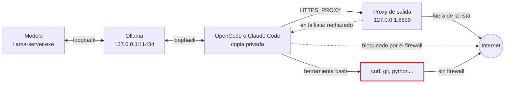

Tengo una LLM local enjaulada. Instalé a mano Ollama, OpenCode, Claude Code y un proxy, y con reglas de firewall le armé una jaula para que no salga a Internet[^img_hero]. La idea era poder trabajar sobre código que algún NDA prohíbe mandar a una LLM en la nube. Cuando la jaula estuvo andando, me pregunté por qué no usar a Claude para escribir un instalador desatendido que la arme sola. **[Este repositorio](https://github.com/CesarBallardini/my-opencode-ollama-environment)**[^repo] es el resultado: un poco inflado, pero piola igual.

Este post cuenta qué problema ataca, qué se gana con un instalador en lugar de una receta, cómo se usa y, sobre todo, qué tan firmes son los barrotes.

> **Antes de confiarle código bajo NDA.** La jaula reduce las formas en que el código puede salir de la laptop, pero **tiene agujeros y todavía no equivale a un _air gap_**. El proxy trabaja con una lista de dominios prohibidos, así que lo que no está en la lista pasa. Y los comandos que corre la herramienta `bash` del asistente no pasan por el firewall ni están obligados a usar el proxy. Más abajo está el detalle. Estás avisado.

## El objetivo

Quiero un asistente de código que use un modelo que corre en mi máquina, sin que el código que le muestro llegue a un tercero. Un modelo local no alcanza para eso, porque el modelo no es lo que abre las conexiones. Las abren tres programas: el asistente que lo maneja (OpenCode o Claude Code, junto con todo lo que ellos lancen), el servidor de Ollama y la aplicación de escritorio de Ollama.

El objetivo del repositorio es que una persona con una laptop con Windows 11 Home clone el repo, revise un archivo de configuración, corra un solo comando y termine con ese entorno armado.

## Cómo está armado

Son cuatro piezas:

- **[Ollama](https://ollama.com/)**[^ollama] escucha sólo en `127.0.0.1`, con las funciones de nube desactivadas, la actualización automática apagada y el modo avión prendido. El modelo por defecto es `qwen3-coder-32k`, un Qwen3-Coder 30B con contexto de 32k; `gpt-oss-64k` es opcional.
- **Copias privadas y fijadas de [OpenCode](https://opencode.ai/)**[^opencode] **y [Claude Code](https://code.claude.com/docs)**[^claudecode], con versión fija y verificación SHA-256 al bajarlas. Tienen su propia configuración y sus propios datos bajo `~/local-llm`, separados de cualquier otra instalación.
- **Un proxy de salida** escrito en Python con la biblioteca estándar, que escucha en `127.0.0.1:8899` y rechaza una lista de 500 dominios: proveedores de modelos, APIs de LLM, repositorios de modelos y sitios donde se puede subir información.
- **Cinco reglas de Windows Firewall** que bloquean la salida directa del `llama-server.exe` que corre el modelo; del servidor y la aplicación de Ollama; y de los dos asistentes privados.

Con eso, el recorrido de una petición queda así:



La flecha de abajo es el agujero, más abajo lo analizamos.

Hay una quinta pieza que evita el error más probable: escribir `claude` en el directorio equivocado. El instalador pone al frente del `Path` del usuario unos _wrappers_ de `opencode` y `claude`. Si el directorio actual está dentro de los que declaraste como confidenciales, arrancan el perfil local. Si no, usan el perfil de nube, si lo instalaste. Si no lo instalaste, avisan y terminan con error.

## El beneficio de la automatización

El instalador agrega lo siguiente:

| Beneficio                      | Cómo se logra                                                                                                                                     |
| ------------------------------ | ------------------------------------------------------------------------------------------------------------------------------------------------- |
| Un solo comando, sin preguntas | `install.cmd` no pide nada, salvo una confirmación de UAC para el firewall (ninguna si la consola ya está elevada)                                |
| Se puede volver a correr       | Cada paso verifica primero qué falta. Si se corta, se corre de nuevo: lo terminado se saltea y la bajada del modelo sigue donde quedó             |
| Respeta lo que ya estaba       | Un Ollama, OpenCode o Claude Code ya instalado queda como está; `verify.cmd` sólo avisa si la versión difiere de la fijada                        |
| Se puede deshacer exactamente  | Cada cambio se anota en un diario, y `uninstall.cmd` revierte lo anotado, deja lo demás como estaba                                               |
| Se puede comprobar             | `verify.cmd` revisa versiones, reglas de firewall, proxy y `Path`, y da PASS, WARN, SKIP o FAIL por línea                                         |
| No hace falta ninguna clave    | El perfil aislado no usa secretos. La clave del perfil de nube, si la querés, vive en un archivo fuera del repo con permisos sólo para tu usuario |

## Cómo se usa

Hace falta Windows 11 de 64 bits, una cuenta de administrador y unos 40 GB libres en `C:` (son unos 21 GB de descarga con el modelo por defecto). Desde una consola, instalá Git y [uv](https://docs.astral.sh/uv/)[^uv], cerrá la consola, abrí otra y cloná el repo:

```powershell
winget install --id Git.Git -e --source winget --accept-package-agreements --accept-source-agreements
winget install --id astral-sh.uv -e --source winget --accept-package-agreements --accept-source-agreements
```

```powershell
git clone https://github.com/CesarBallardini/my-opencode-ollama-environment.git
cd my-opencode-ollama-environment/
```

**Este paso es obligatorio.** En `install.config.json` hay una plantilla que tenés que reemplazar por los directorios cuyo código no puede salir:

```json
"confidential_roots": ["%USERPROFILE%\\YOUR_CONFIDENTIAL_FOLDER"]
```

El instalador no controla que la hayas cambiado. Para que los nombres de tus carpetas no queden en el clon, copiá el archivo a otro lado, editá la copia y pasásela a los programas con `--config`.

```powershell
# ver que va a hacer:
.\install.cmd --dry-run

# instalar todo:
.\install.cmd

# verificar la instalación:
.\verify.cmd
```

La salida va paso por paso. Este es un pedazo real de `--dry-run` en mi laptop, donde Ollama ya estaba y faltaba configurarlo:

```text
[models]
  already done
[app-settings]
  pending: set auto_update_enabled=0 in the Ollama app settings
  pending: set airplane_mode=1 in the Ollama app settings
  dry run: no change
```

Para trabajar, abrí Git Bash, andá al proyecto y usá alguno de estos comandos:

| Comando                          | Qué corre                                                               |
| -------------------------------- | ----------------------------------------------------------------------- |
| `opencode-local`                 | OpenCode con el modelo local, en el perfil aislado                      |
| `claude-local`                   | Claude Code con `qwen3-coder-32k`                                       |
| `opencode`, `claude`             | el perfil local dentro de un directorio confidencial, el de nube afuera |
| `opencode-cloud`, `claude-cloud` | el perfil de nube, sin condiciones                                      |

Vale la pena mirar `~/local-llm/egress.log` la primera vez: el proxy anota ahí lo que dejó pasar y lo que rechazó. Para deshacer todo:

```powershell
#sólo muestra que va a hacer para deshacer, sin hacerlo:
.\uninstall.cmd

# deshace lo que instaló el instalador
.\uninstall.cmd --yes
```

El único resto es el Python 3.14 que maneja uv, porque el desinstalador corre sobre él. El programa te imprime el comando para sacarlo a mano. Y si `~/local-llm` lo creó el instalador, se borra entero, con tus sesiones adentro.

## Lo que está probado y lo que no

Lo de «un poco inflado» tiene números: son 3563 líneas de programas y 3163 de tests, para un instalador. La suite tiene 169 tests sobre una laptop simulada y 18 de integración contra el sistema operativo real, y la cobertura da 99,54 %.

Lo que todavía **no** corrí es la instalación completa en una laptop nueva o en una máquina virtual. El repo trae el script para la máquina virtual, pero falta usarlo.

## Las decisiones que son mías

Este proyecto lo escribí en colaboración con Claude, de Anthropic, que escribió el código, los tests y la documentación. El README lo dice en el primer párrafo. Las decisiones fueron mías:

- **El objetivo**: que usar el modelo local equivalga a estar desconectado, para poder trabajar sobre código confidencial.
- **Que se pueda volver a correr de manera idempotente**, y que respete cualquier instalación previa.
- **Que el desinstalador revierta sólo lo que el instalador hizo**.
- **Python 3.14 y las compuertas de calidad de [localenv-python](https://github.com/CesarBallardini/localenv-python)**[^localenv], con todas las capas de tests: unitarios, BDD, integración y punta a punta.
- **Type hinting a fondo**: `Any` y `object` son una señal de alarma, lo mismo que las supresiones de tipado.

Todas las instalaciones las realicé manualmente, escribiendo los mandatos y descargando instaladores y modelos, mucho click por acá y por allá. Como me dio pereza escribir la documentación para hacerlo a mano en otra laptop, usé a Claude para que lo escribiera en forma de programa.

En mi pobre laptop, la velocidad de lectura y generación de tokens sobre una base de código de unos 130 kLOC fue lamentable. Pero no quiero desalentarte, sobre todo si tenés mejor hardware.

Si te sirve, ¡bienvenido!

[^img_hero]: Imagen de [Cable closet bh](https://commons.wikimedia.org/wiki/File:Cable_closet_bh.jpg) — Dominio público — Brian Hankins, 2005. Recortada a 2.5:1 para hero landscape.

[^repo]: [CesarBallardini/my-opencode-ollama-environment](https://github.com/CesarBallardini/my-opencode-ollama-environment), repositorio en GitHub, con licencia MIT.

[^ollama]: [Ollama](https://ollama.com/) — servidor para correr modelos en la propia máquina.

[^opencode]: [OpenCode](https://opencode.ai/) — asistente de código para la terminal. El repo fija la versión 1.18.34.

[^claudecode]: [Claude Code](https://code.claude.com/docs) — asistente de código de Anthropic para la terminal. El repo fija la versión 2.1.292.

[^uv]: [uv](https://docs.astral.sh/uv/) — gestor de paquetes y proyectos Python de Astral.

[^localenv]: [CesarBallardini/localenv-python](https://github.com/CesarBallardini/localenv-python), repositorio en GitHub — el modelo del que salieron las compuertas de calidad.
